# The game screen's layout (design pod, 2026-10-15)

Cory, on a round-II screenshot: "the log generally doesn't take up much space. We could be using that space or use a different layout — too much prime real estate was given to the log. Think it over."

**Choice: A, "who | where | what to buy."** It's the default now on any laptop 1200px wide or more. Narrower laptops keep the old grid, and phones keep their stacked layout.

## What was wrong (before, 1270×700)
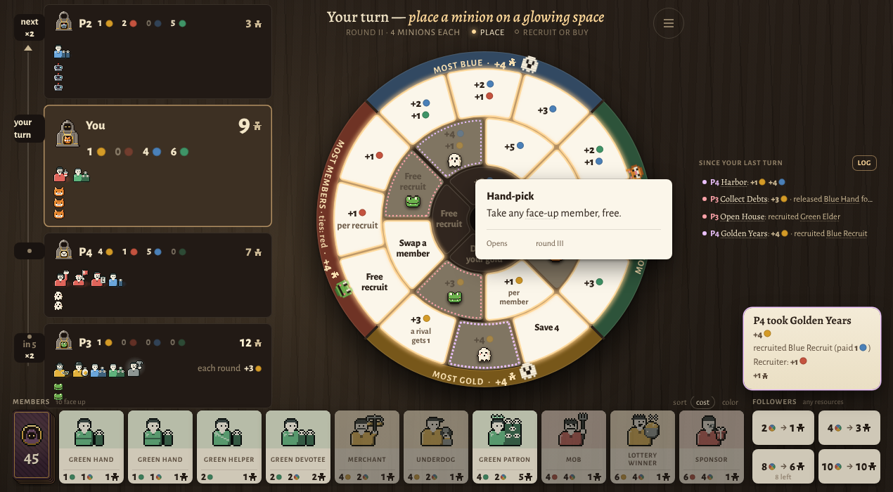

- The right third (261×552px) held only the since-strip: four 12px lines, 50px tall, floating in the middle. The rest was empty walnut.
- The shop strip ran under everything (128px tall, full width). The wheel can only be as tall as the screen allows, so the strip took its height and the wheel stopped at 478px. The space beside the wheel stayed empty.
- The turn card floated at the bottom right with nothing to hold it.
- The shop strip and the empty column fail the slop list's "a layout that wastes half the screen while cramming the other half".

## What deserves the space
At 1270×700 the wheel is the board, and the screen's height limits it, not the width. Anything laid out as a row (the shop strip) costs the wheel height. Anything laid out as a column costs width the wheel isn't using. So the furniture should stand in columns, and every column should have a job:
1. **The wheel:** the largest thing on screen, as tall as the screen allows.
2. **The shop and the follower buys:** what you buy after you place. Keep them together and give them equal weight (Cory: "the follower buys get the same prominence as the member shop").
3. **Your seat and the rivals' seats, in turn order with the snake:** small panels, one glance each.
4. **The since-strip and the turn card:** small. They tell the rivals' turns, so they belong next to the rivals.

## The variants
All variants are CSS only and keep the same elements, with nothing added.

**A: who | where | what to buy (chosen).** On the left, the seats in turn order (snake rail and order marks unchanged). Under them sit the since-strip, then the turn card, so the newest turn reads last. The wheel runs the full height in the middle. On the right is the shop as a column: the deck heads the members like a card, three to a row, and the four follower buys sit right under them. This is Cory's own phrase from 2026-10-14: the shop is "a slim strip beside the wheel".

| setup | your turn, round II | a rival's turn | round III |
|---|---|---|---|
| 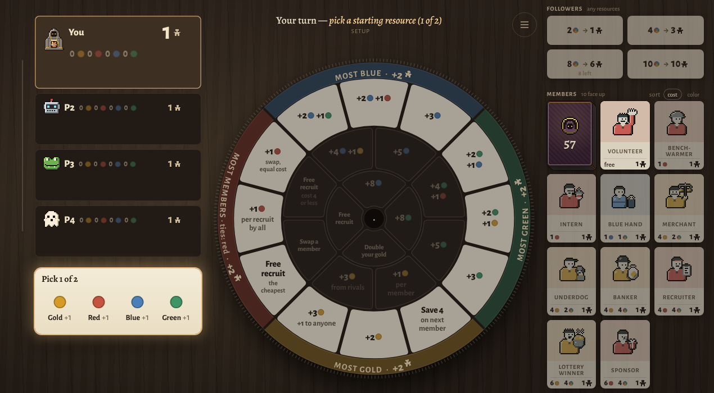 | 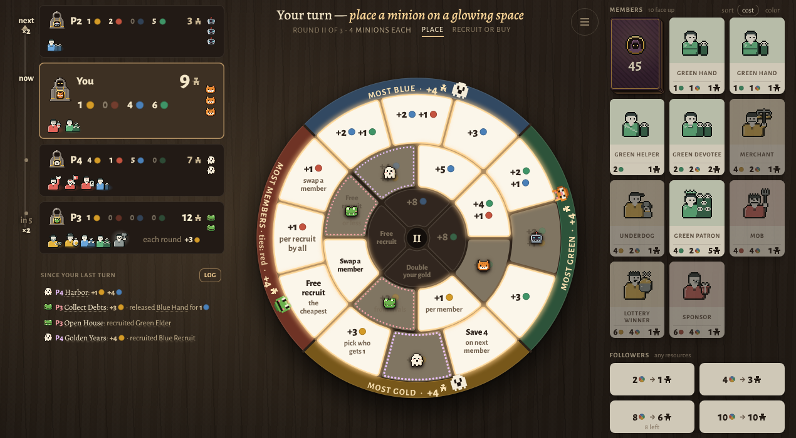 | 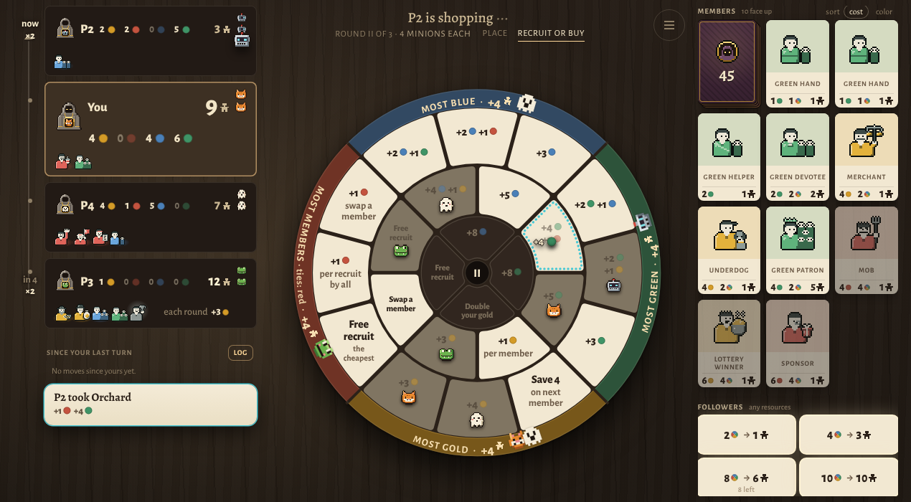 | 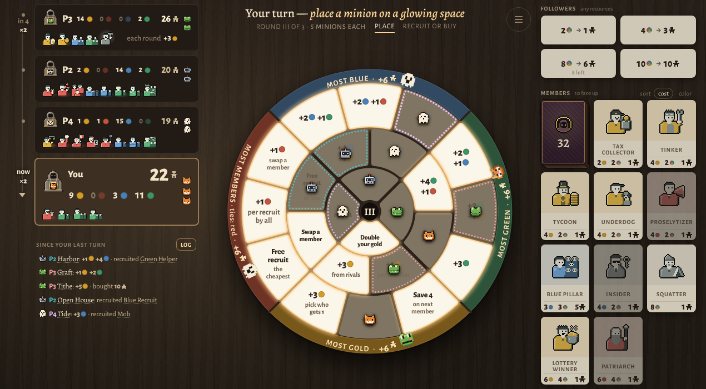 |

Your buy step: 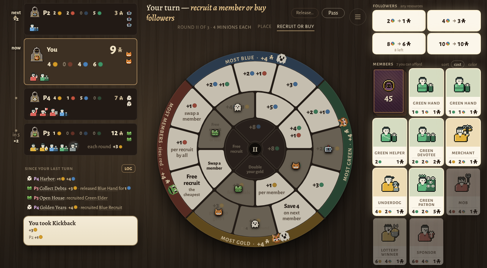 · At 1440×860 the wheel grows to ~640px: 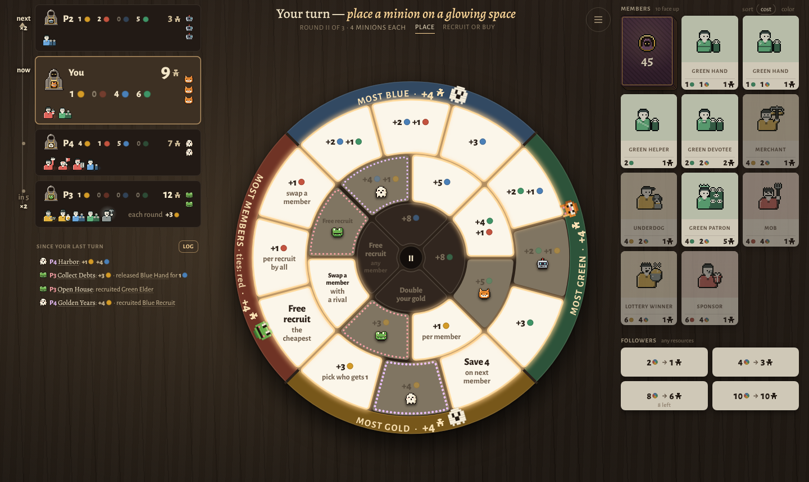

**B: the followers get the right column.** The bottom strip keeps the deck and members, so each card gets wider (111px). The right column holds the since-strip at the top, the turn card, and the four follower buys at the foot. The rules are kept for the record in `layout/variant-b.css`. They aren't in the game.

| setup | your turn, round II | a rival's turn | round III |
|---|---|---|---|
| 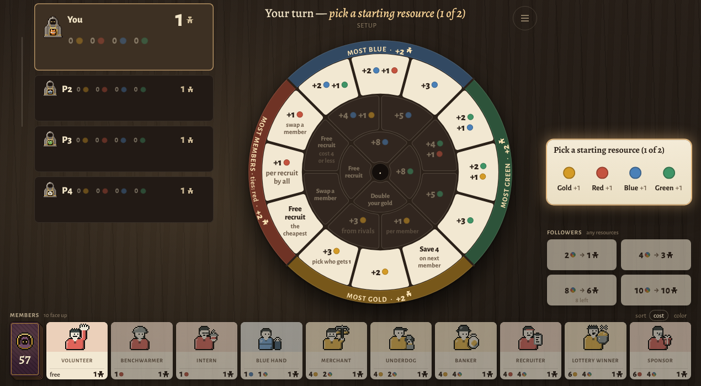 | 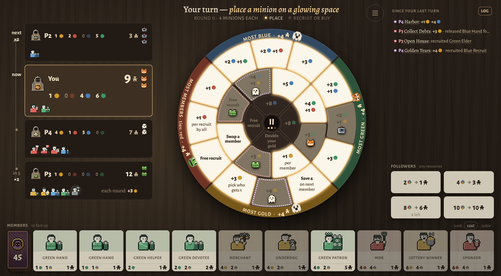 | 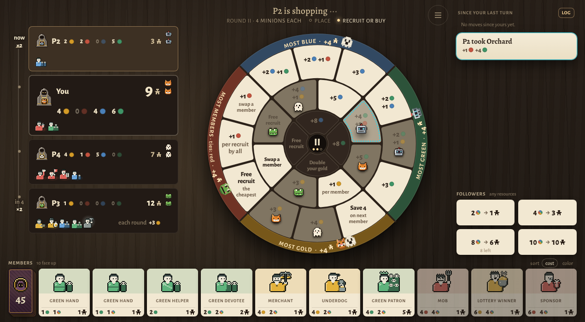 | 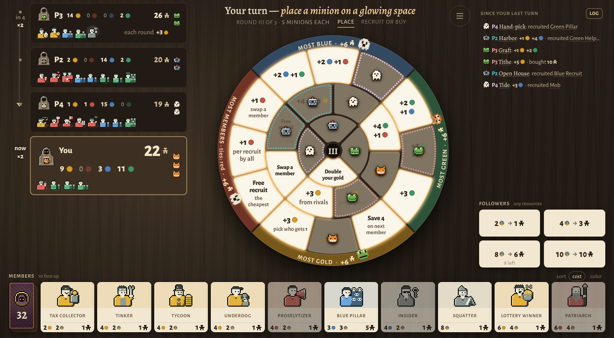 |

Old layout, for comparison: setup 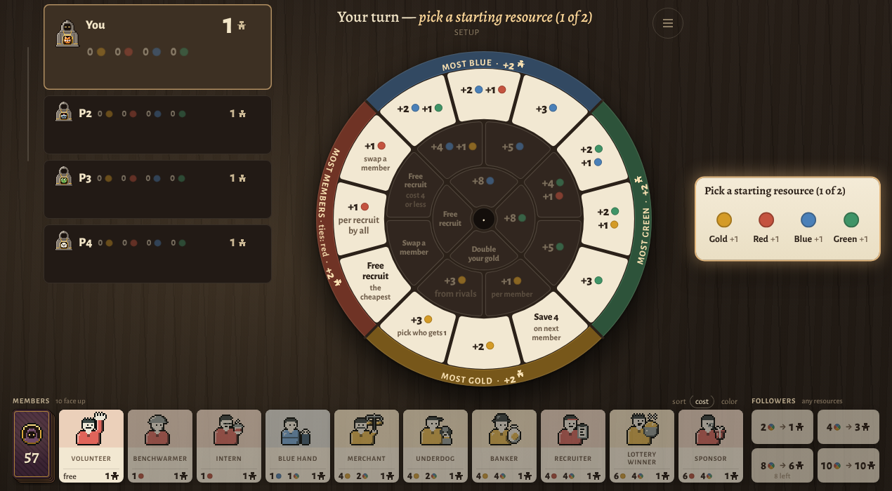 · round III 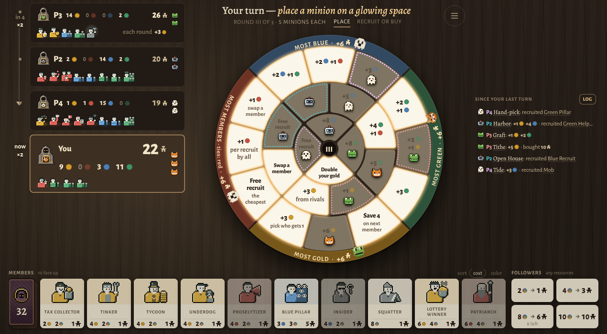 · a rival's turn 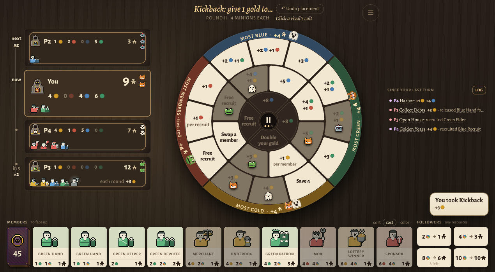

## Why A
- **One job per column, and all three are full.** Who's at the table, where you go, what you buy. The eye goes left to right through a turn: the seats (what happened), the wheel (place), the shop (buy). B still leaves a hole in the right column between the since-strip and the follower buys whenever no turn card is up, which is most of your own turn.
- **The wheel gets bigger.** It goes from 478px to about 512px at 1270×700, because nothing runs under it any more, and to about 640px at 1440×860. In B it stays at 478px, because the strip still takes its height.
- **The shop reads as one market.** The members and the follower buys sit in one column, at the same weight, and are lit the same way when you can buy. The deck sits at the head of the members like a card, not in front of a row. The cards grow toward the plate's portrait shape (88×130px, from 92×104px).
- **The since-strip sits next to the rivals it describes**, at the size it needs, which is a few short lines. The turn card docks right under it in a fixed place, so the story runs top to bottom: older moves, then the turn happening now. It no longer floats.
- **Alignment.** All three columns run from the top edge to the bottom edge. The shop's foot and the turn card's foot land on the same line.
- Nothing was added or reworded, and no game rule changed.

## Costs and limits (honest)
- A needs a 340px seat column, or a seat's top row collides (seen at 1100px: the total ran into the resources). Below 1200px wide A would shrink the wheel below the old layout's, so the old grid stays there (`@media (min-width:1200px)` in `src/v4/game/layout.css`). The rejected narrow shots are `layout/a-1100x700/place.png` and `a-900x700/place.png`.
- The since-strip has whatever height is left under the seats, minus 112px kept for the turn card. In round III that's about 6 lines with the current seat heights. Past that, the oldest lines clip first. The newest never clip, and the whole log is one tap away (Log).
- At setup the starting-resource picker moves under the seats, where the since-strip will later be. That column is empty until the turns begin. The picker never covers the wheel or the members you're picking toward. The layout gate (l6) passes.

## Files
- `src/v4/game/layout.css`: the composition from 1200px up (new; imported by GameScreen.jsx).
- `src/v4/game/GameScreen.jsx`: the turn card docks under the since-strip when the layout sets `--turn-dock: since`. The seats stack from the column's top when it sets `--seats-align: start`, and they write `--seats-end` (their foot) for whatever sits under them. The old grid keeps both old behaviours.
- `e2e/v4/layout.mjs`: its buy-step loop now answers a choice on the board (a rival's seat or stack), as the game asks since pick-on-board. Before, it only clicked the old choice buttons and stalled on Kickback at every size. No assertion changed.
- Tools: `scripts/design-pod/capture.mjs` (the key states at any size; `--strip layout.css` and `--css <file>` photograph the old grid and variant B), `scripts/design-pod/measure.mjs` (region boxes).
